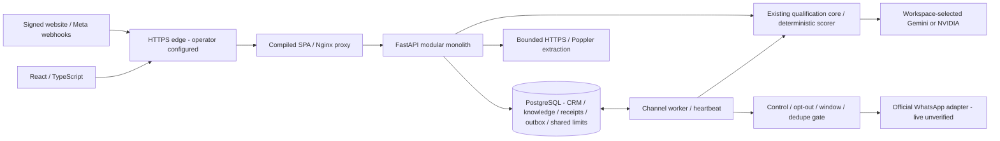
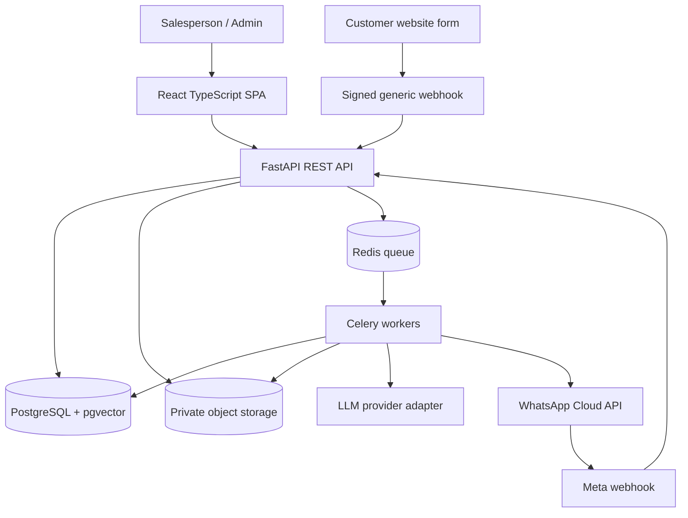
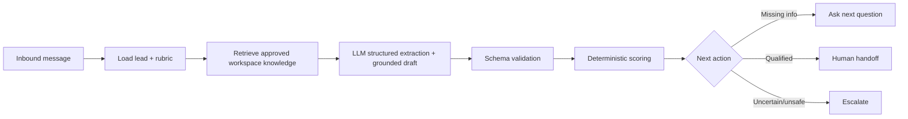

# EasyCRM — System Design & Architecture

**Version:** 0.1 · **Design status:** Proposed · **Style:** Modular monolith with async workers

**Session 5 implemented architecture:** the diagram immediately below describes the current release. Later diagrams are historical targets; Redis/Celery, vectors and object storage are not runtime dependencies. Approved manual/website/PDF text shares the existing lexical source store. HTTPS fetches pin vetted public DNS answers and review is mandatory. Poppler extraction discards originals. Shared rate counters, worker heartbeat, privacy audits and processing timestamps are PostgreSQL-backed. See [release report](SESSION_5_RELEASE_REPORT.md) and [operations/deployment](DEPLOYMENT.md) for execution evidence and limits.



```mermaid
sequenceDiagram
  participant Source as Signed website / Meta
  participant API as FastAPI
  participant DB as PostgreSQL
  participant Worker as Channel worker
  participant AI as Configured provider
  participant Human as Inbox salesperson
  Source->>API: HMAC-authenticated event
  API->>DB: Scoped integration lock, unique receipt + normalized envelope
  API-->>Source: 202 after durable commit
  Worker->>DB: Claim receipt, dedupe identity, save lead/message
  Worker->>DB: Commit processing marker before inference
  Worker->>AI: Approved workspace excerpts + structured extraction request
  AI-->>Worker: Structured result or sanitized failure
  Worker->>DB: Validate evidence, deterministic score, audit + outbox plan
  Human->>API: Takeover with reason
  API->>DB: Control version + cancel queued AI messages
  Worker->>DB: Final mode/opt-out/window/version check
  Note over Worker,DB: Website never sends externally; ambiguous sends are not retried
```

**Implemented Session 3 update:** The existing FastAPI/React/PostgreSQL monolith now includes immutable qualification templates, one canonical qualification conversation per lead, immutable message/control events, reviewed-text lexical retrieval and deterministic scoring. No workers, vectors, uploads or outbound dispatch were added. `services/qualification.py` owns processing and returns a validated action plan; the caller owns the transaction. A nonblocking lead row lock serializes inference and control changes, while a workspace lock serializes template version allocation/activation. See [SESSION_3_HANDOFF.md](SESSION_3_HANDOFF.md) for the implemented state machine, failure/replay behavior and the outstanding Session 2/4 boundaries. The diagrams below remain the broader target architecture.

**Implemented Session 4 update:** PostgreSQL receipts, internal contact identities, channel threads and a message outbox now provide durable channel processing without introducing Redis/Celery dependencies. `python -m app.channel_worker` runs separately, commits claims before inference/HTTP send, and leaves ambiguous sends for reconciliation. Verified adapters resolve workspace authority server-side. Channel workers explicitly share the existing canonical qualification thread; control versions and final policy checks prevent stale AI sends. See [SESSION_4_HANDOFF.md](SESSION_4_HANDOFF.md) for actual contracts, locking, retries and verification boundaries. The Celery/Redis/object-store diagrams below remain future architecture.

## 1. Architecture decision

Start with **one FastAPI backend** organized by domains plus Celery workers, a React SPA, PostgreSQL/pgvector, Redis and private object storage. This supports strong separation and avoids unnecessary microservice overhead. Use an AI provider adapter; do **not** require multi-agent orchestration.



## 2. Modules

| Module | Responsibility |
| --- | --- |
| identity | auth, users, workspace membership, roles |
| organization | business profile, service regions, policy and product metadata |
| crm | contacts, leads, pipeline stages, notes, assignments, event history |
| ingestion | authorized website fetch/PDF text extraction, chunking, embedding, publication/version |
| qualification | criteria templates, field extraction, scoring, evidence and next question |
| conversations | messages, channel conversations, AI/human control, outgoing policy gate |
| integrations | signed generic webhook adapter, Meta verification, phone number mapping |
| jobs | durable event processing, retries, dead-letter/failed status, scheduled cleanup |
| analytics | aggregate counts by source/status and operational measurements |
| audit | admin changes, agent tool calls, handoff and sensitive modifications |

## 3. Data model (logical)

```text
workspaces(id, name, created_at)
users(id, email, password_hash, ...)
memberships(workspace_id, user_id, role)
business_profiles(id, workspace_id, name, industry, site_url, region, ...)
knowledge_sources(id, workspace_id, kind, url_or_object_key, state, version, approved_at)
knowledge_chunks(id, workspace_id, source_id, text, embedding, metadata)
qualification_templates(id, workspace_id, name, version, published)
qualification_criteria(id, template_id, field_key, question, weight, required, rule)
contacts(id, workspace_id, name, phone_e164, email_normalized, consent_state)
leads(id, workspace_id, contact_id, title, source_type, pipeline_stage,
      qualification_status, qualification_score, owner_user_id)
lead_events(id, workspace_id, lead_id, event_type, payload_json, received_at)
conversations(id, workspace_id, lead_id, channel, external_thread_id, mode)
messages(id, workspace_id, conversation_id, direction, external_message_id,
         text, status, created_at)
integration_sources(id, workspace_id, kind, credential_ref, active)
webhook_deliveries(id, integration_source_id, external_event_id, payload_hash, status)
ai_executions(id, workspace_id, lead_id, template_version, model, output_json, usage_json)
audit_events(id, workspace_id, actor_id, action, target_id, metadata, created_at)
```

**Required database rules:** composite workspace-scoped indexes; unique memberships; unique `(integration_source_id, external_event_id)` for webhook delivery; unique `(workspace_id, channel, external_message_id)` when external ID provided; keep external identifiers distinct from internal IDs. Consider `UNIQUE(workspace_id, phone_e164)` and `UNIQUE(workspace_id, email_normalized)` only after explicitly defining merge rules/partial indexes for nullable identities. Store external payloads with restricted retention and redaction.

## 4. Trust and isolation

- Workspace identity comes from **authenticated membership** for user APIs; for webhooks it comes from a verified and active **integration source**, never JSON `workspace_id` supplied by a caller.
- Always filter SQL/vector queries by workspace ID; optionally add PostgreSQL row-level security as defense in depth, not substitute for app checks.
- Document files in private object storage paths separated per workspace; signed short-lived access URLs only.
- Admin controls knowledge publication. Do not treat scraped/attached text as instructions. Constrain allowed domains and block SSRF (private IPs, redirects to forbidden hosts, metadata endpoints).
- Encrypt secret refs, never return secrets in API responses or logs. Rotate webhook keys and Meta tokens.
- Restrict agent tools to explicit allowed actions. Never let model generate arbitrary SQL or directly send messages without policy checks.

## 5. Event processing — generic form webhook

1. Receive `POST /api/v1/webhooks/forms/{source_id}`; read **raw** request bytes.
2. Verify active source + HMAC header (and optional timestamp tolerance); enforce body size and rate limits.
3. Validate schema; write `webhook_deliveries` record in transaction with unique event ID, then return a `202 Accepted` after durable acceptance.
4. Queue worker using delivery ID; on failure, retry safely with backoff and terminal error visibility.
5. Worker normalizes identity, identifies/creates contact, upserts/creates lead according to merge policy, adds source lead event, updates delivery state.
6. AI qualification is queued **only if** contact channel consent and business routing permit; form ingestion alone does not imply WhatsApp opt-in.

## 6. WhatsApp processing

- GET challenge verification and POST event receiver per Meta API configuration. Verify request signature using Meta app secret on raw body.
- Immediately durably store unique provider events and acknowledge; process asynchronously.
- Map WABA/phone_number_id -> active workspace integration; verify message scope before creating contact/conversation.
- On inbound, save message once, update channel service-window timestamp, then check conversation `mode` and opt-out flags.
- If in AI mode and eligible, retrieve business knowledge and run qualification; outgoing message passes Meta's session/template policy before enqueueing send.
- Persist outbound intent with a stable idempotency key to reduce duplicate sends; record provider message id and delivery status.
- Human takeover uses a transactional mode switch; worker **rechecks mode immediately before send** to prevent stale queued replies.
- Provider delivery may be at least once; design for deduplication and state reconciliation. Exactly-once external sends cannot be guaranteed after a network ambiguity.

## 7. AI qualification pipeline



- Tool outputs include extracted fields, optional evidence snippets/source IDs, confidence labels, and suggested question.
- The scorer alone produces `score` and status using versioned configuration.
- Add prompt-injection tests, structured-output validation, retries/fallbacks, and human escalation when source evidence is absent.
- Avoid sending raw entire documents to model; retrieve only scoped relevant chunks with source/version references.

## 8. Deployment/environment

**Local:** Docker Compose for Postgres + pgvector, Redis, FastAPI, worker, frontend (and optional S3-compatible storage emulator).

**Production later:** managed PostgreSQL, private object store, HTTPS reverse proxy, isolated worker, monitoring/error alerts, secret manager, backups, controlled migrations. Public HTTPS callback required for Meta webhook testing; use a secure tunnel in local development.

## 9. Observability and evaluation

- JSON logs with `request_id`, `workspace_id`, `delivery_id`, `conversation_id`, `lead_id` (avoid PII values).
- Dashboard health: webhook accept/failed, queue backlog, AI timeouts, unanswered/handed-off leads, inbound-to-first-response times.
- Golden evaluation dataset: labeled intents, product inquiries, missing qualification details, policy unknowns, cross-tenant adversarial docs, opt-outs.
- Include latency, token cost, accuracy by field, and unsupported answer counts with each evaluation run.

## 10. Architecture decisions to revisit

- Auth strategy (local JWT vs OIDC), provider-specific contact matching rules, durable outbox design, PDF library choice, embedding model, vector dimensions and reindex strategy, retention/deletion deadlines, and real-time inbox updates (polling initially vs WebSocket later).
